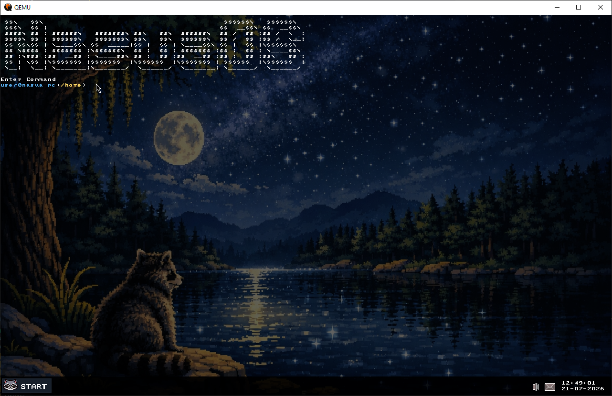

# NasuaOS

**A modern hobby operating system built from scratch.**

[About](#about) · [Project Information](#project-information) · [Screenshots](#screenshots) · [Documentation](#documentation) · [Building](#building)

---

## About

NasuaOS is an experimental operating system developed from the ground up, focused on learning, low-level programming, kernel development, and building a complete system independently.

The project primarily targets **x86** architecture, with portability in mind. Experimental support is planned for **AArch** and **RISC-V**, although these targets remain untested.

The project includes its own kernel, memory manager, drivers, graphical user interface, shell, filesystem, and applications. Every component is designed specifically for NasuaOS without relying on existing operating system kernels.

The long-term goal is to create a modern, lightweight operating system capable of running on both virtual machines and real hardware.

## Project Information

| Property | Details |
|:---|:---|
| Project type | Hobby operating system |
| Primary architecture | x86 |
| Additional architectures | AArch, RISC-V |
| Primary language | C++ |
| Additional languages | C, Assembly |
| Development tools | Python |
| License | MIT |

## Target Architectures

| Architecture | Support |
|:---|:---|
| **x86_64** | Primary target |
| **AArch64** | Experimental |
| **RISC-V** | Experimental |

## Community & Links

## Share NasuaOS

## Documentation & Development

| Resource | Description |
|:---|:---|
| [📚 Documentation](documentation/main_page.md) | Technical documentation |
| [🔨 Build Instructions](documentation/build_instructions/build_instructions.md) | How to build NasuaOS |
| [🤝 Contributing](CONTRIBUTING.md) | Contribution guidelines |
| [📦 Download ISO/HDD builds](https://github.com/Szatakis/NasuaOS/releases#release-latest) | Prebuilt system images |

## Screenshots

## Documentation

Documentation for NasuaOS can be found in the `documentation/` directory.

Additional technical information, architecture notes and driver documentation will be added as the project grows.

## Building

Currently NasuaOS can be built on Linux using GCC and CMake.

For detailed build instructions, dependencies and configuration, see:

[🔨 **Build Instructions**](documentation/build_instructions/build_instructions.md)

## Prebuilt Images

Prebuilt NasuaOS images are available in the [releases](https://github.com/Szatakis/NasuaOS/releases#release-latest).

The branch contains automatically generated builds:

| Image | Description |
|:---|:---|
| `NasuaOS.iso` | Bootable ISO image for QEMU, VirtualBox and real hardware |
| `NasuaOS.hdd` | HDD disk image for virtual machines |

## Contributing

Contributions, bug reports and feature suggestions are welcome.

If you would like to contribute, please open an issue or submit a pull request.

For contribution guidelines, see [CONTRIBUTING.md](CONTRIBUTING.md).

## Author

**Szatakis**

## Acknowledgments & Credits

This project includes components from the [NasuaOS Bootloader](https://github.com/Szatakis/NasuaOS-Bootloader/) repository.

These components are part of my internal ecosystem. Please refer to the [bootloader repository](https://github.com/Szatakis/NasuaOS-Bootloader/) for full license information and original source documentation.

## License

NasuaOS is released under the **MIT License**.

See [LICENSE.md](LICENSE.md) for details.

---